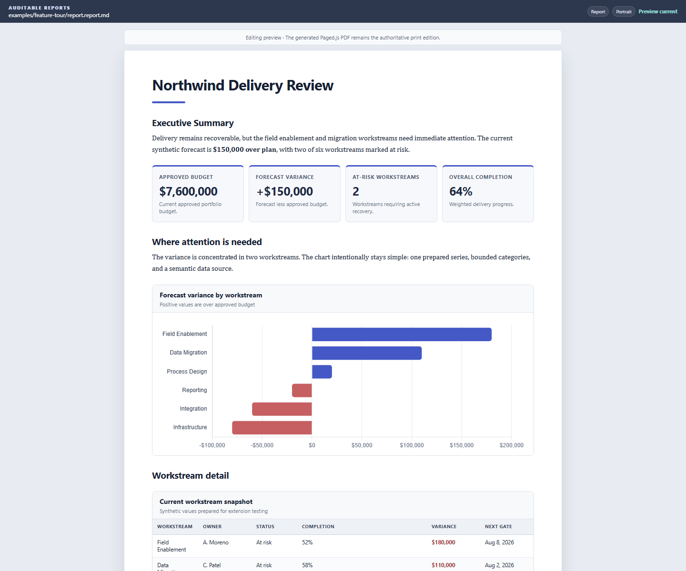

# Auditable Reports for VS Code

Write constrained Report Markdown as ordinary text and keep a polished report preview open beside it. The extension recompiles after each edit, renders the canonical `artifact.json` result, and shows compiler errors on the source line that needs attention.



## Author in text, review visually

- Recognizes `*.report.md` files as **Report Markdown**.
- Opens a live preview beside the source with **Ctrl+K V** or **Auditable Reports: Open Preview to the Side**.
- Preserves normal VS Code text editing, search, source control, undo, and agent workflows.
- Renders prose, lists, links, code blocks, metric strips, semantic tables, figures, and bounded bar, line, pie, or scatter charts.
- Uses bundled Chart.js for the editing preview.
- Honors document profile, source visibility, page orientation, and other safe report settings.
- Reports invalid directives and front matter through VS Code diagnostics and the **Auditable Reports** output channel.
- Routes ordinary `.md` files to VS Code's built-in Markdown preview instead of treating them as malformed reports.

The preview is intentionally derived output. Report Markdown compiles through the same canonical compiler used by the report tooling, and `artifact.json` remains the report intermediate representation.

## Get started

1. Install Python 3 and this extension.
2. Open a saved `*.report.md` file and its JSON data or evidence sidecar.
3. Select the preview button in the editor title, run **Auditable Reports: Open Preview to the Side**, or press **Ctrl+K V**.
4. Edit the Markdown. The preview refreshes after a short debounce.
5. Save sidecar data or image changes to refresh their dependent preview.

The included [feature tour](examples/feature-tour/report.report.md) exercises metrics, both supported chart types, a semantic table, a code block, an SVG figure, sources, and print configuration.

## Constrained building blocks

Ordinary Markdown supplies the narrative. A small set of fenced directives supplies report elements:

```markdown
::: chart
id: variance_by_workstream
type: bar
title: Forecast variance by workstream
dataset: workstreams
source: portfolio_snapshot
category: workstream
value: variance
format: currency
:::
```

Snippets are included for a new report, metric strip, chart, semantic table, and figure. Type `report`, `metrics`, `chart`, `table`, or `figure` in a Report Markdown editor to insert one.

The DSL deliberately limits charts to one prepared series: 12 bars, 24 unique line-chart x values, 6 positive pie slices, or 50 numeric scatter points. Tables remain limited to eight columns, metric strips to six values, and datasets to bounded reviewed rows. Those constraints keep authored files predictable and printable.

## Preview versus print

The editing preview is designed for fast authoring and structural review. It does not emulate physical page boundaries. The normal Auditable Reports bundle remains responsible for:

- Chart.js materialization at the print boundary
- Paged.js pagination, running content, and page numbers
- Exact Letter, Legal, or A4 dimensions
- PDF `MediaBox`, overflow, and page-level validation
- Canonical evidence and final stakeholder-edition policies

This division keeps typing responsive while preserving one authoritative print pipeline.

## Local and restricted by design

Report contents stay local. The webview has no remote-resource permission, accepts only compiled artifacts, and reconstructs figures from validated embedded image data. Live preview is disabled in an untrusted workspace because it invokes the bundled compiler through the machine's Python runtime.

If Python is not on `PATH`, set **Auditable Reports: Python Path** in user settings. The setting is machine-scoped and cannot be supplied by an untrusted workspace.

## Supported source names

Use `*.report.md` for new files. The conventional `stakeholder-report.md` name is also recognized for existing decision-brief workspaces. Any saved Markdown file with valid report front matter can be previewed from the Command Palette.

## CSS and report styling

Report-specific CSS files are intentionally not loaded by the editing preview. The extension has a bundled
preview stylesheet, while final print styling comes from the shared Auditable Reports renderer and Paged.js.
Put safe choices such as profile, page size, orientation, source visibility, date display, and semantic table
roles in Report Markdown. Keep a legacy `stakeholder-report.css` only as a migration reference; do not expect
it to change the canonical preview or PDF.

See [Migrating an HTML/CSS report](https://github.com/incursa/auditable-reports-vsce/blob/main/docs/MIGRATING-LEGACY-REPORTS.md) for the one-time mapping
from legacy mastheads, callouts, HTML tables, images, page-break classes, and custom CSS.

## Supported boundaries

- The extension is desktop-only because canonical compilation uses Python.
- Unsaved edits in JSON sidecars are not compiled; save the sidecar to refresh.
- The preview does not synchronize scrolling or provide click-to-reveal navigation.
- The preview shows page-break markers, not exact Paged.js pages.
- Final PDF generation runs through the report bundle rather than from the extension.

These boundaries do not introduce alternate report formats; every preview continues to compile through `artifact.json`.

## License and brand assets

Extension code and documentation are licensed under Apache-2.0. The Auditable Reports name and product assets listed in [BRAND-ASSET-LICENSE.md](BRAND-ASSET-LICENSE.md) are governed separately and are not licensed under Apache-2.0.
